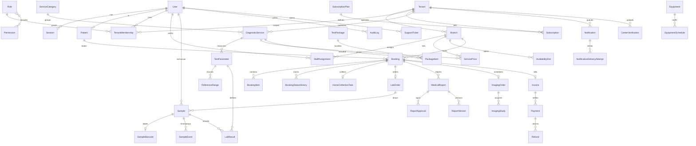

# Data model

Money is stored in paise. Clinical rows carry `tenantId`. Files live in private storage; the database keeps the key, checksum, and access audit.

Extra tables used by the implementation: `SubscriptionPlan`, `Invitation`, `PasswordReset`, `Equipment`, `PackageItem`, `WebhookEvent`, `IdempotencyRecord`.
